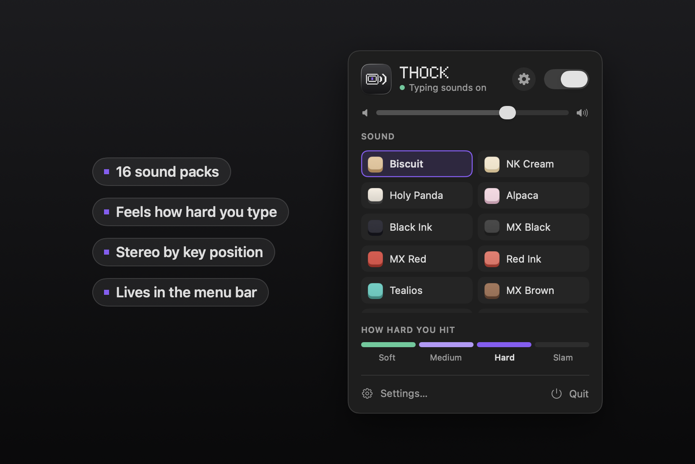
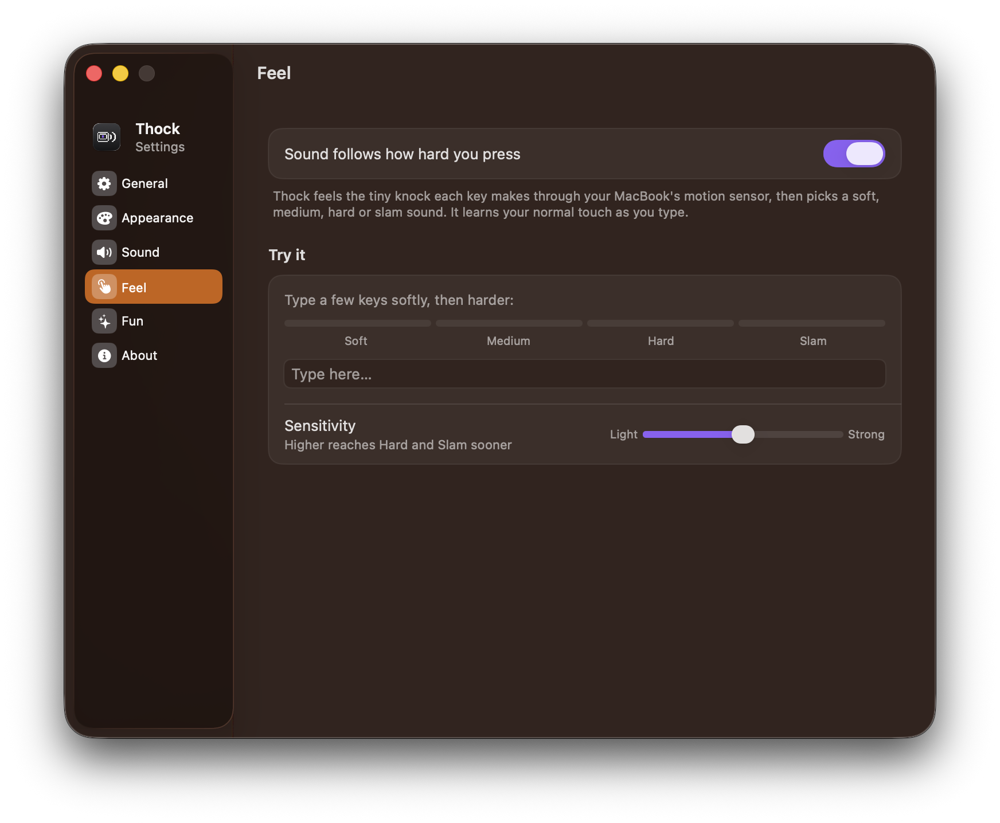
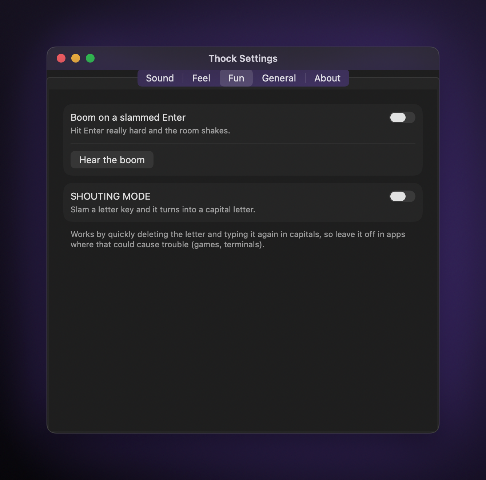

  

<h1 align="center">Thock</h1>

<b>Mechanical keyboard sounds for your MacBook.</b> The harder you hit, the louder it clicks.

  <a href="https://github.com/kakhaliel/Thock-Releases/releases/latest/download/Thock.dmg"><b>⬇&nbsp; Download Thock for Mac</b></a>
  &nbsp;·&nbsp;
  <a href="https://khalidkhalil.dev/apps/thock">Hear it in your browser</a>
  &nbsp;·&nbsp;
  <a href="https://github.com/kakhaliel/Thock-Releases/releases">All versions</a>

Free · macOS 13 Ventura or later · Apple Silicon and Intel

---

Thock lives in the menu bar and makes your MacBook keyboard sound like a real mechanical keyboard. It feels how hard you press each key through the MacBook's built-in motion sensor, and plays a soft, medium, hard or slam sound to match.

## What it does

- **16 sound packs**: Cherry MX, Holy Panda, NK Cream, Topre, Buckling Spring and more.
- **Feels every press**: soft, medium, hard or slam, read from the motion sensor. It learns your normal touch.
- **Stereo by key position**: keys on the left sound from the left speaker, keys on the right from the right.
- **Pitch variety**: every click is a little different, so long typing never sounds like a loop.
- **Clarity filter**: keeps each click crisp on small speakers.
- **Quiet with headphones**: it can play on the built-in speakers only.
- **Just for fun**: a boom when you slam Enter, and Shouting mode, which turns a slammed letter into a capital.

  
  
  

## Install

1. [Download `Thock.dmg`](https://github.com/kakhaliel/Thock-Releases/releases/latest/download/Thock.dmg), open it and drag **Thock** into **Applications**.
2. Open Thock. The first time, macOS says it can't check the app, because Thock isn't notarised by Apple yet. Click **Done**, then go to **System Settings → Privacy & Security**, scroll down and click **Open Anyway**. You only do this once.
3. Let Thock hear the keyboard: **System Settings → Privacy & Security → Accessibility**, then turn on **Thock**. Thock only notices which key went down; it never reads what you type.

> Key-strength sensing needs an Apple Silicon MacBook. On other Macs every key plays at the same strength.

## Updating

Download the newest `Thock.dmg` from the link above and drag it into Applications again, replacing the old one. After an update, macOS may ask for the Accessibility permission again: turn Thock off and on in the same place.

## About this repo

This repo only hosts the finished app for download. The source code is private.

The keyboard recordings come from the open-source **Mechvibes** and **ClickClack** projects and are used under the MIT License; the full credits are in the app's About tab.

---

Made by <a href="https://khalidkhalil.dev">Khalid Khalil</a> · info@khalidkhalil.dev · © 2026

