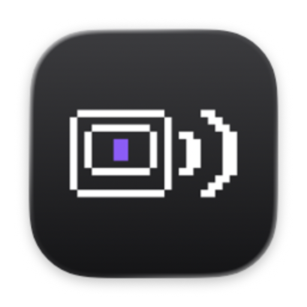
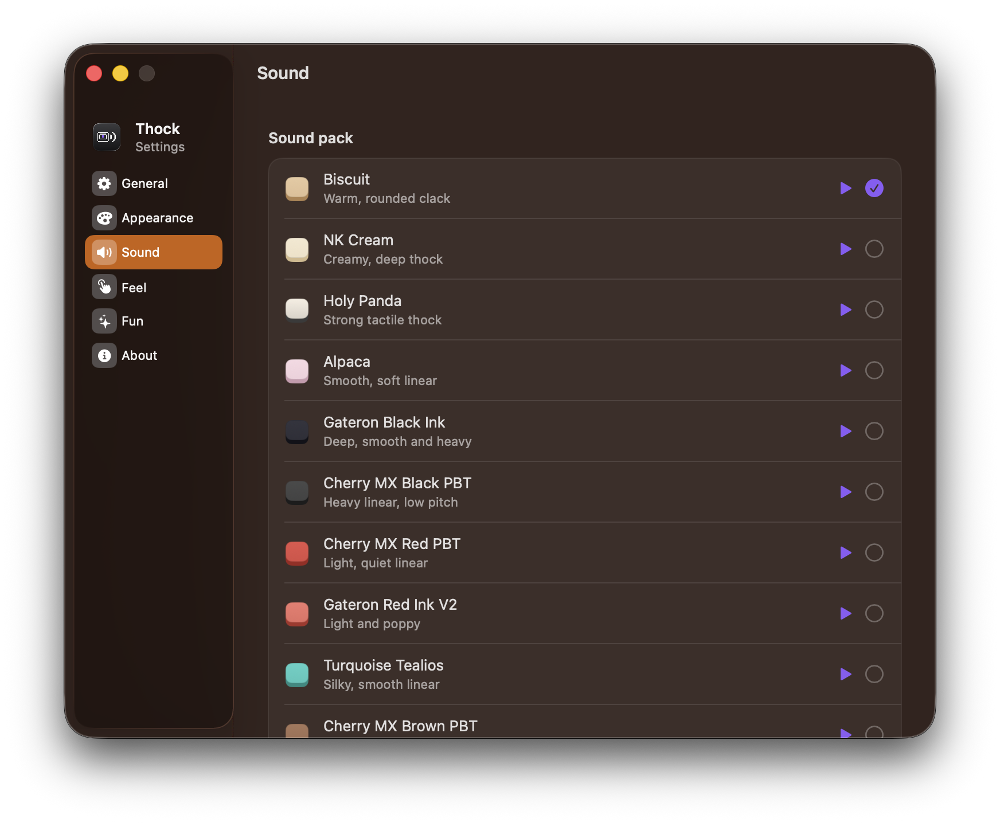
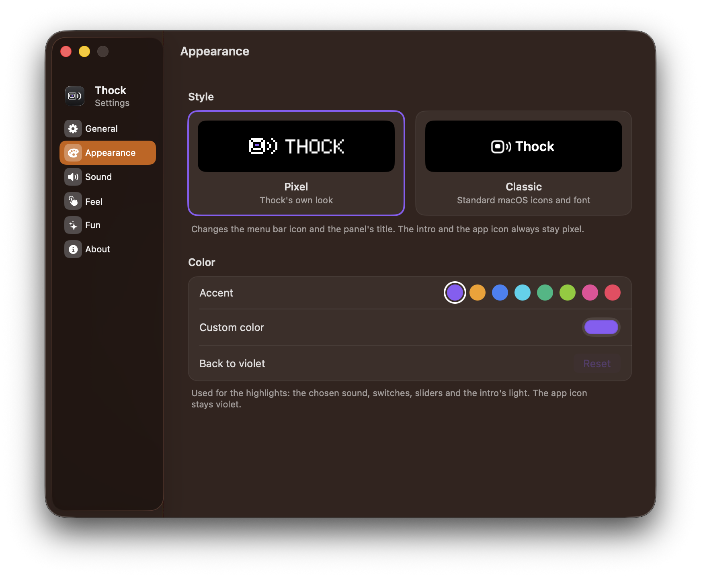
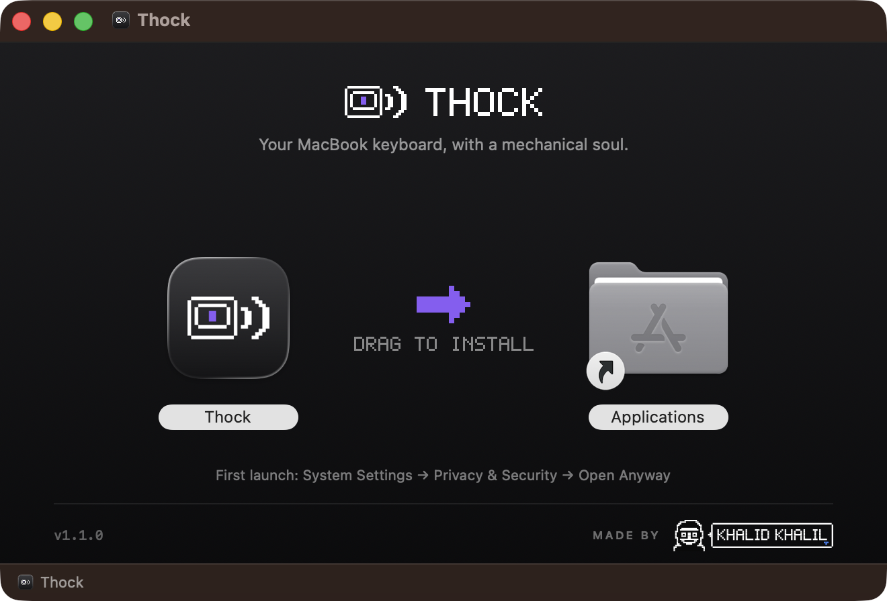

  

<h1 align="center">Thock</h1>

  <b>Mechanical keyboard sounds for your MacBook.</b> 
  The harder you hit, the louder it clicks.

  

  
  
  

  

## Download

Get **[Thock.dmg](https://github.com/kakhaliel/Thock-Releases/releases/latest/download/Thock.dmg)** (latest version) or pick a version on the [Releases](https://github.com/kakhaliel/Thock-Releases/releases) page. Free. You can also [hear it in your browser](https://khalidkhalil.dev/apps/thock) first.

## Features

Thock lives in the menu bar and makes your MacBook keyboard sound like a real mechanical keyboard. It feels how hard you press each key through the MacBook's built-in motion sensor, and plays a soft, medium, hard or slam sound to match.

### 16 sound packs
Cherry MX, Holy Panda, NK Cream, Topre, Buckling Spring and more. Tap one to hear it. You can add your own packs too.

- **Stereo by key position**: keys on the left sound from the left speaker, keys on the right from the right.
- **Pitch variety**: every click is a little different, so long typing never sounds like a loop.
- **Clarity filter**: keeps each click crisp on small laptop speakers.
- **Quiet with headphones**: it can play on the built-in speakers only.

### Feels every press
Soft, medium, hard or slam, read from the motion sensor. Thock learns your normal touch as you type, and you can set how sensitive it is.

### Just for fun
A boom when you slam Enter, and Shouting mode, which turns a slammed letter into a capital.

### Your look
Pixel style (Thock's own look) or Classic (standard macOS icons and font), and any accent color you like.

## Install & first launch

1. Open `Thock.dmg` and drag **Thock** into **Applications**.
2. Open Thock. The first time, macOS says it can't check the app: click **Done**, then go to **System Settings → Privacy & Security** and click **Open Anyway**. (Thock is signed ad-hoc, without an Apple Developer ID.) You only do this once.
3. Thock lives in the **menu bar** (the keycap icon). Click it to pick a sound, or open **Settings…** from there.

**Updating:** download the newest `Thock.dmg` and drag it into Applications again, replacing the old one. After an update, macOS may ask for the Accessibility permission again: turn Thock off and on in the same place (or remove it with **−** and add it back).

## Permissions

| Permission | Why |
|---|---|
| Accessibility | To notice when a key goes down, so it can play a sound. Thock never reads or records what you type. |

Thock works offline and sends nothing anywhere.

## Requirements

macOS 13 Ventura or newer, Apple Silicon or Intel. Key-strength sensing needs an Apple Silicon MacBook; on other Macs every key plays at the same strength.

## What's new

See [CHANGELOG.md](CHANGELOG.md).

---

This repository holds releases only; the source code is private. The keyboard recordings come from the open-source **Mechvibes** and **ClickClack** projects and are used under the MIT License (full credits in the app's About page).

  Developed by <a href="https://khalidkhalil.dev">Khalid Khalil</a> · info@khalidkhalil.dev · © 2026 Khalid Khalil

